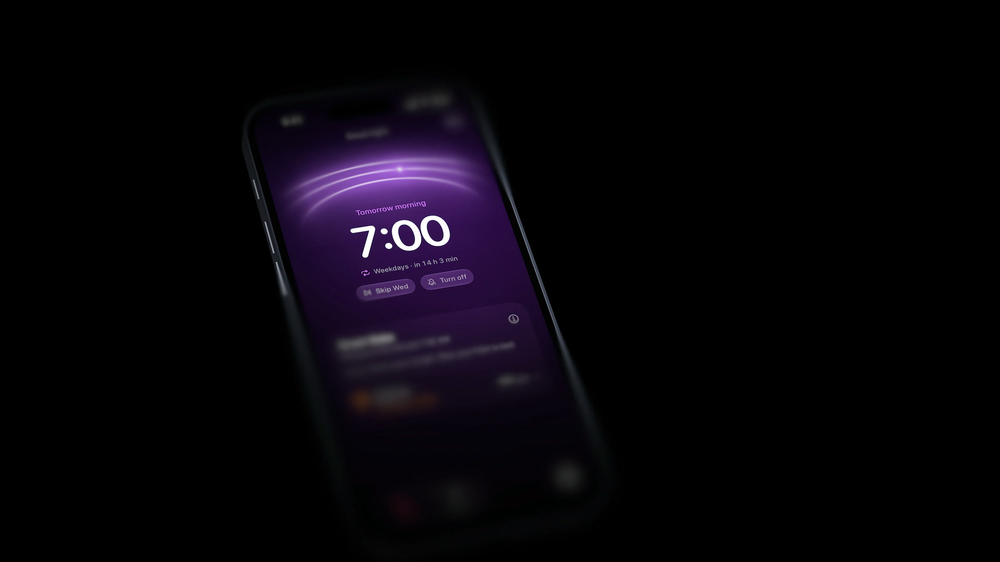
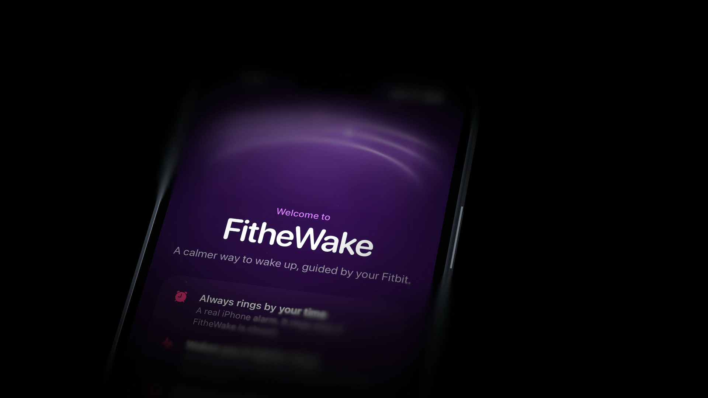
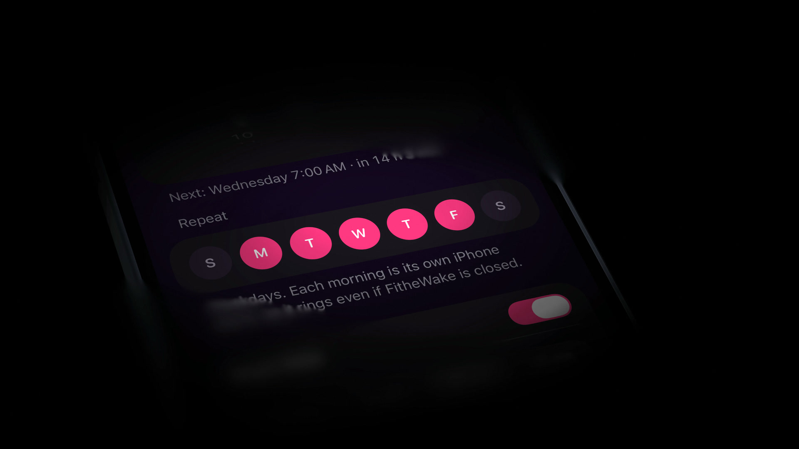
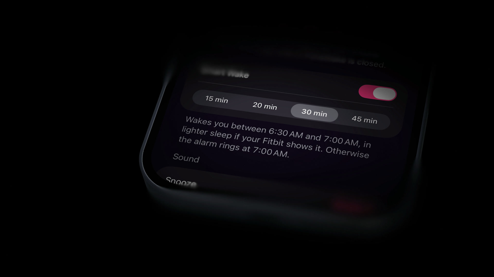

# FitheWake

<p align="center">
  
</p>

An iOS alarm clock that can wake you a little earlier, at a lighter moment of
sleep, using live heart rate from a Fitbit. The alarm you set always rings.

- **A real alarm first.** Every alarm is a native AlarmKit alarm. It rings at
  the time you set, in Silent Mode, with the app closed and with no wearable.
- **Experimental Smart Wake.** Inside a window you choose (15–45 minutes before
  the alarm), FitheWake reads heart rate over Bluetooth and may ring early when
  you are probably not in deep sleep. It never cancels the final alarm. How it
  decides, and what the research does and doesn't support, is in
  [docs/SMART_WAKE_RESEARCH.md](docs/SMART_WAKE_RESEARCH.md).
- **Private.** No account, server, analytics or HealthKit. Heart rate stays on
  the phone.
- **Repeating alarms** on the days you pick, with "skip tomorrow".

FitheWake is an experiment, not a medical device. Smart Wake has been checked on
synthetic nights and short real-world runs, not validated against sleep-lab
recordings. Keep a second alarm until you trust it.

<p align="center">
  
  
  
</p>

## Requirements

- iOS 26 or later; Xcode 26 or later to build.
- For Smart Wake, a wearable that shares standard Bluetooth heart rate. It is
  built and tested with a Fitbit Air (Google Health app → Connections → Fitbit
  Air → Share heart rate). The alarm works without one.

## Build

```sh
git clone https://github.com/rashi123123/fithewake.git
cd fithewake
swift test -c release -Xswiftc -enable-testing
open FitheWake.xcodeproj
```

To run on an iPhone, create `Config/Local.xcconfig` (git ignores it) with your
team and a bundle ID prefix you own:

```
DEVELOPMENT_TEAM = YOUR_TEAM_ID
BUNDLE_ID_PREFIX = com.yourname
```

Then build in Xcode, or run `./scripts/build_and_run.sh`. The project has no
third-party dependencies. [docs/TESTING.md](docs/TESTING.md) covers simulator
builds, UI tests and hardware tests.

## Documentation

- [Architecture](docs/ARCHITECTURE.md): how the code is organized and the rules
  that keep the alarm safe.
- [Smart Wake research](docs/SMART_WAKE_RESEARCH.md): the evidence, the engine
  and its evaluation.
- [Testing](docs/TESTING.md).
- [Contributing](CONTRIBUTING.md) and [Security](SECURITY.md).

## License

[MIT](LICENSE).
